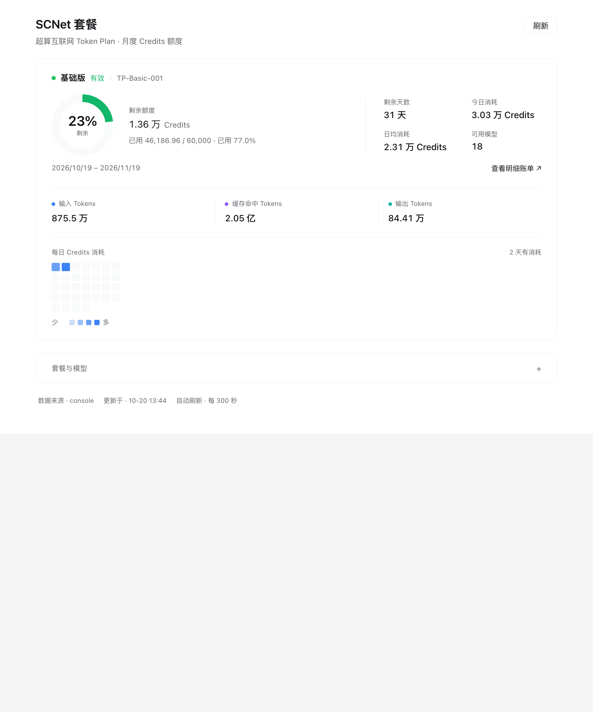
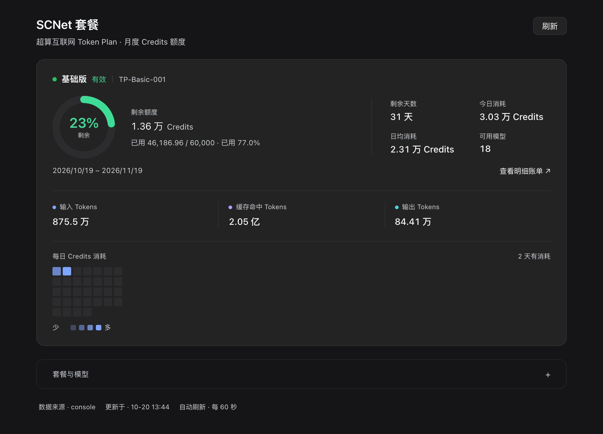

# dsh-scnet-plan

**在 DeepSeek Harness 里直接看 SCNet Token Plan 还剩多少，不用再开控制台。**

SCNet（超算互联网）的 Token Plan 按月发 Credits，但余额只有登录控制台才看得到。装上这个插件后：

- 侧栏多一个面板：**剩余比例圆环、今日/日均消耗、每日热力图、token 构成**，一眼看完；
- 输入框下方有个小徽标，随时显示剩余百分比；
- 直接问模型「我还剩多少额度」，它会用 `get_scnet_plan` 自己查。

| 浅色 | 深色 |
| --- | --- |
|  |  |

## 安装

需要先装好 DeepSeek Harness（桌面版或 CLI）。在 DSH 对话里让 agent 调 `plugin_manager install_bundle`，`target` 按下面的方式填：

| 方式 | target | 说明 |
| --- | --- | --- |
| **GitHub 源**（免 clone，推荐） | `github:Ronnie-Young/dsh-scnet-plan#v0.0.1` | pnpm 直接拉取，不用本地目录 |
| **Release 压缩包** | `https://github.com/Ronnie-Young/dsh-scnet-plan/releases/download/v0.0.1/dsh-scnet-plan-0.0.1.tgz` | 从 GitHub Release 直链安装 |
| 本地目录（开发/排错） | `/你的路径/dsh-scnet-plan` | 需要先 `git clone` |
| npm（首次发布后启用） | `dsh-scnet-plan` | 发布后一行安装 |

> 安装会申请 danger-full-access 权限，按提示批准。装完**刷新页面**，侧栏出现「SCNet 套餐」图标就成功了。

如果还想更省事，也可以让 agent 直接读这个仓库的 README，把上面的 target 告诉它。

## 第一次使用：登录一次

打开 **设置 → SCNet 套餐**，两种方式任选：

1. **短信验证码**（推荐）：填手机号 → 获取验证码 → 输入 6 位码 → 登录；
2. **账号密码**：填账号密码，需要图形验证码时按提示输入。

登录成功后插件会先用这个会话真读一次订阅，确认能读到额度才保存。

> **隐私**：手机号、验证码、密码只用于这一次登录请求——不保存、不写日志、不显示、不进模型上下文。之后自动刷新只用会话 Cookie。

## 面板上都是什么

| 区域 | 内容 |
| --- | --- |
| 圆环 | 剩余百分比，>20% 绿、6.7–20% 琥珀、<6.7% 红 |
| 右侧 | 剩余天数、今日消耗、日均消耗、可用模型数 |
| 中间 | 剩余 Credits + 已用/总额度 |
| token 行 | 输入 / 缓存命中 / 输出（缓存命中是 SCNet 单独计量的，不是输入的子集） |
| 热力图 | 订阅周期内每天的 Credits 消耗，蓝色 4 档 |
| 底部 | 明细账单入口；「套餐与模型」可展开看档位和模型清单 |

每日用量读取失败不影响额度数字，面板会提示。

## 可选配置

一般不用改。想调刷新频率、预警线、关闭工具时，在 profile 的 `cordis.patch.yml` 里覆盖：

```yaml
- id: scnet-plan
  config:
    refreshIntervalSec: 300   # 秒；0 = 只手动刷新
    warnBelowPercent: 20      # 低于此比例转琥珀色
    tool: true                # 是否注册 get_scnet_plan
    accountLogin: true        # 是否允许设置页登录
```

<details>
<summary>完整配置项</summary>

| 字段 | 默认值 | 说明 |
| --- | --- | --- |
| `apiKeyEnv` | `SCNET_API_KEY` | API Key 的凭据引用名（只用于列模型） |
| `baseUrl` | `https://api.scnet.cn` | OpenAI 兼容网关 |
| `consoleBaseUrl` | `https://www.scnet.cn` | 控制台地址 |
| `apiBasePath` | `/api/llm/v1` | 网关路径前缀 |
| `consoleCookieEnv` | `SCNET_CONSOLE_COOKIE` | 会话 Cookie 的凭据引用名 |
| `refreshIntervalSec` | `300` | 缓存与自动刷新间隔 |
| `requestTimeoutMs` | `15000` | 单次请求超时 |
| `includeModels` | `true` | 是否附带模型列表与套餐目录 |
| `warnBelowPercent` | `20` | 预警线 |
| `routePath` | `/scnet-plan/snapshot` | Host 快照路由 |
| `tool` | `true` | 注册 `get_scnet_plan` |
| `manageCookie` | `true` | 允许手动粘贴 Cookie（高级退路） |
| `accountLogin` | `true` | 允许短信/密码登录 |
| `loginTimeoutSec` | `30` | 登录请求超时 |

</details>

## 常见问题

**面板显示「待连接」？**
还没登录。去 设置 → SCNet 套餐 登录一次。

**数字一直不变？**
默认 5 分钟刷新一次；点面板右上角「刷新」可立即拉取。SCNet 自己的统计也有约 5 分钟延迟。

**过几天又提示登录失效？**
会话 Cookie 会过期，重新登录一次即可。密码和验证码从不保存。

**能用 API Key 代替登录吗？**
不能。`sk-tp-…` 只能列模型，额度接口只认控制台会话——这也是为什么要登录一次。

**不想用了？**
`plugin_manager remove_bundle target = dsh-scnet-plan`。

## 更新

```bash
git pull
```

然后在 DSH 里重新安装（`remove_bundle` 再 `install_bundle`），刷新页面。发版与发布流程见 [docs/publishing.md](docs/publishing.md)。

## 开发

```bash
npm test                      # 36 个单测
node scripts/probe.mjs --self-test
```

`client.js` 是手写的浏览器 bundle，不需要打包器；改完刷新页面即可。

项目结构与接口细节见 [docs/scnet-api.md](docs/scnet-api.md) 和 [docs/plugin-platform.md](docs/plugin-platform.md)。

## License

MIT © Ronnie-Young

[](https://github.com/deepseek-ai/deepseek-harness)
